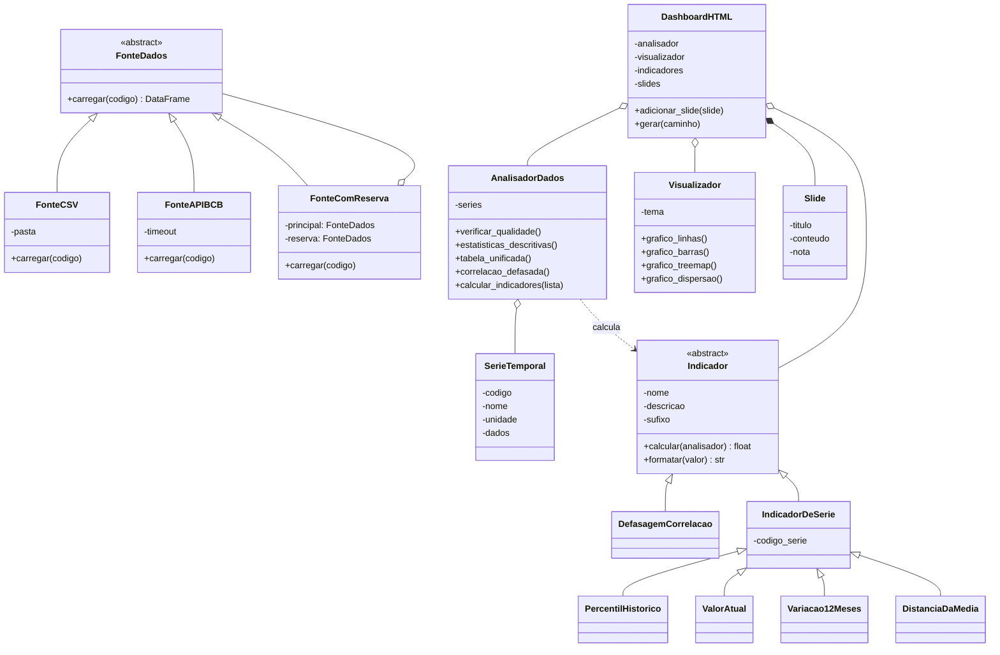

# ProjetoEconomia

Sistema de análise de dados e dashboard interativo sobre a **inadimplência
do crédito no Brasil e sua relação com o custo do crédito** (2011–2026),
desenvolvido em Python com Programação Orientada a Objetos e Pandas para o
Projeto Final de POO (CDIA).

## Fonte de dados

Banco Central do Brasil — Sistema Gerenciador de Séries Temporais (SGS),
via [Portal de Dados Abertos](https://dadosabertos.bcb.gov.br/).

| Código | Série | Unidade |
|---|---|---|
| [21082](https://dadosabertos.bcb.gov.br/dataset/21082-inadimplencia-da-carteira-de-credito---total) | Inadimplência da carteira de crédito - Total | % da carteira |
| [25433](https://dadosabertos.bcb.gov.br/dataset/25433-taxa-media-mensal-de-juros-das-operacoes-de-credito---total) | Taxa média mensal de juros das operações de crédito - Total | % ao mês |

Os dados são lidos dos CSVs em `dados/brutos/`. Se um arquivo não existir,
o sistema busca a mesma série na API do SGS.

## Estrutura

```
ProjetoEconomia/
├── main.py            fluxo principal: monta os objetos e mostra os resultados
├── config.py          caminhos e séries usadas
├── fontes/            de onde vêm os dados (CSV, API, CSV com reserva na API)
├── modelos/           SerieTemporal e exceções do projeto
├── analise/           AnalisadorDados
├── indicadores/       Indicador (abstrata) e os indicadores do dashboard
├── visualizacao/      Visualizador (gráficos Plotly)
├── dashboard/         Slide e DashboardHTML (apresentação em slides)
├── dados/brutos/      CSVs baixados do Banco Central
└── tests/             testes unitários (unittest)
```

## Diagrama de classes



| Classe | Responsabilidade |
|---|---|
| `FonteDados` (abstrata) | Contrato de qualquer origem de dados: `carregar(codigo)` |
| `FonteCSV`, `FonteAPIBCB` | Leem a série do CSV baixado ou da API do SGS |
| `FonteComReserva` | Usa uma fonte principal e, se ela falhar, uma reserva |
| `SerieTemporal` | Guarda uma série: código, nome, unidade e valores |
| `AnalisadorDados` | Exploração, tratamento e análises com Pandas |
| `Indicador` (abstrata) | Contrato de todo KPI: `calcular()` e `formatar()` |
| `IndicadorDeSerie` | Base dos indicadores calculados sobre uma série |
| `ValorAtual`, `Variacao12Meses`, `DistanciaDaMedia`, `PercentilHistorico` | Nível atual, variação em 12 meses e posição no histórico |
| `DefasagemCorrelacao` | Com quantos meses de atraso uma série acompanha a outra |
| `Visualizador` | Gera os gráficos Plotly |
| `Slide` | Uma tela da apresentação: título, conteúdo e interpretação |
| `DashboardHTML` | Monta a apresentação em slides e grava o HTML |

## Como executar

```bash
python -m venv .venv
# Windows: .venv\Scripts\activate   |   Linux/Mac: source .venv/bin/activate
pip install -r requirements.txt
python main.py
```

## Testes

```bash
python -m unittest discover -s tests -t .
```
