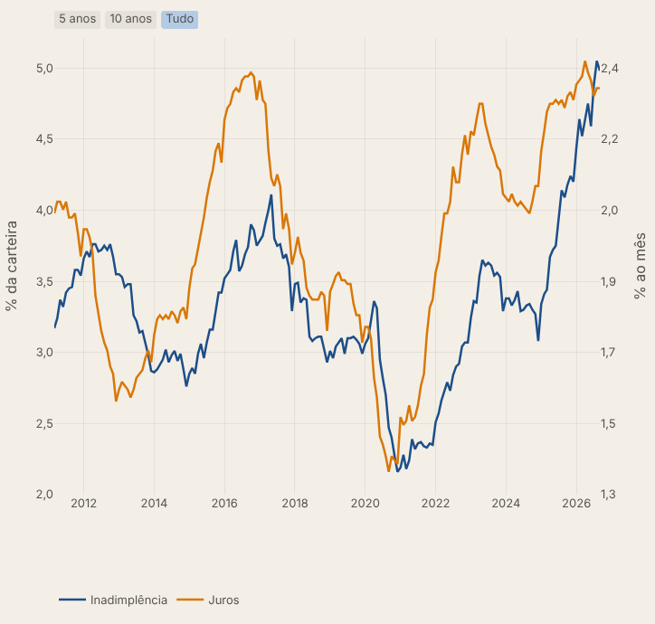
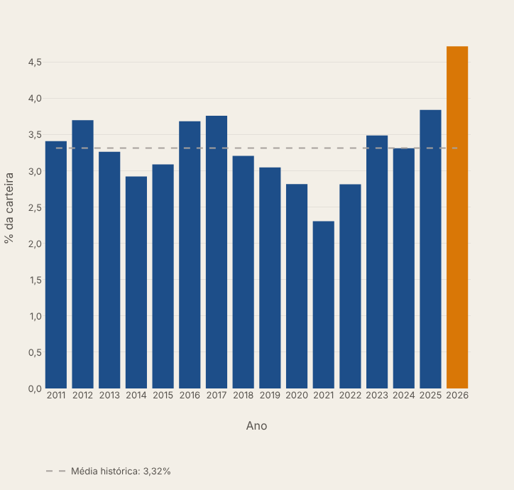
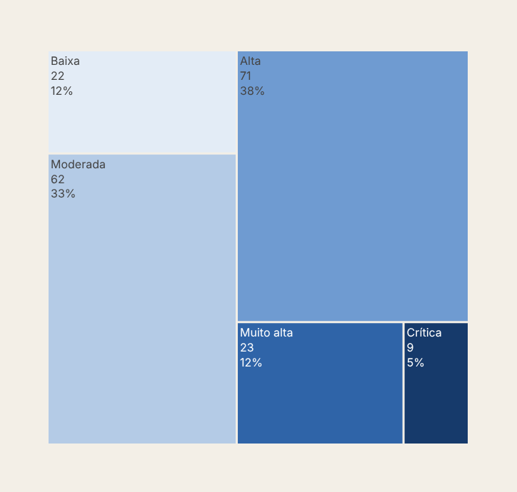
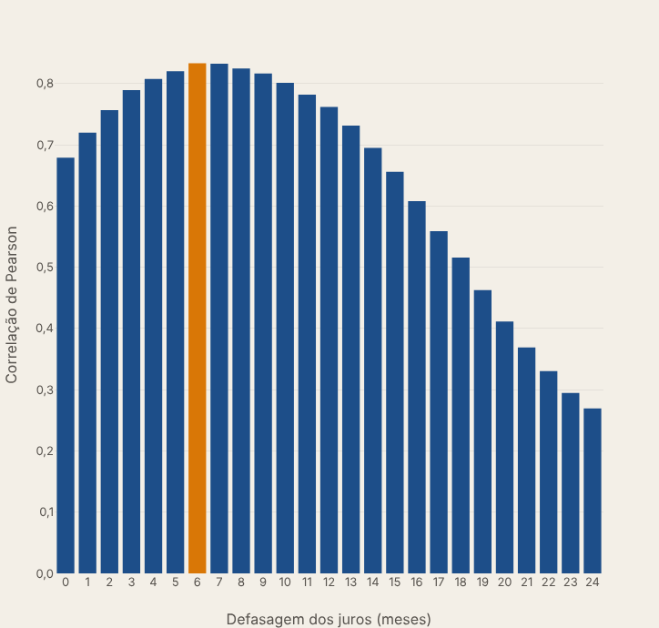
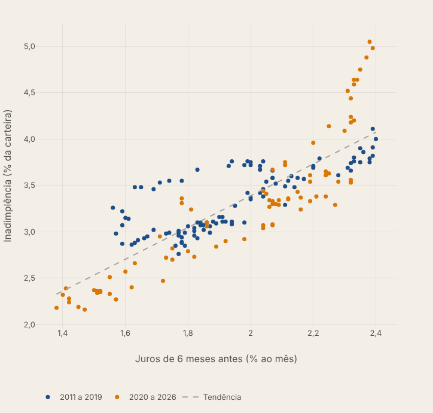
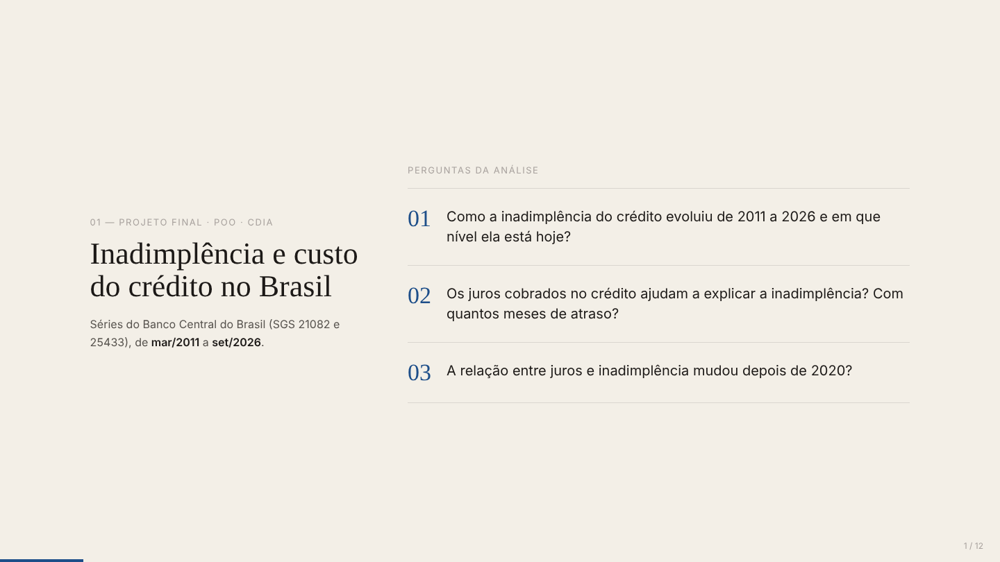

# Inadimplência e custo do crédito no Brasil

Projeto Final de Programação Orientada a Objetos — Ciência de Dados e Inteligência Artificial (PUC).

Sistema em Python que busca duas séries do Banco Central, trata e analisa os dados com Pandas, calcula indicadores e gera um dashboard em formato de apresentação.

**[Abrir o dashboard](dashboard.html)** · [Código no GitHub](https://github.com/dugrossi/ProjetoEconomia)

## Sumário

1. [Justificativa do tema](#justificativa)
2. [Fonte pública de dados](#fonte)
3. [Variáveis utilizadas](#variaveis)
4. [Tratamento e análise dos dados](#tratamento)
5. [Arquitetura orientada a objetos](#arquitetura)
6. [Classes e responsabilidades](#classes)
7. [Indicadores](#indicadores)
8. [Gráficos e interpretação](#graficos)
9. [Funcionamento do dashboard](#dashboard)
10. [Conclusões e limitações](#conclusoes)
11. [Como executar e testar](#executar)
12. [Referências](#referencias)

---

## 1. Justificativa do tema {#justificativa}

A inadimplência do crédito é um problema que afeta famílias, empresas e bancos ao mesmo tempo. Quando ela sobe, os bancos ficam mais cautelosos, o crédito encarece e quem já está endividado tem mais dificuldade para pagar. Em 2026 a inadimplência chegou ao maior nível da série histórica, o que tornou o tema atual.

Escolhemos analisar a inadimplência junto com a **taxa de juros** porque os juros são o custo do crédito: é o fator que pesa mais diretamente no valor da parcela. A análise tenta responder três perguntas:

1. Como a inadimplência do crédito evoluiu de 2011 a 2026 e em que nível ela está hoje?
2. Os juros cobrados no crédito ajudam a explicar a inadimplência? Com quantos meses de atraso?
3. A relação entre juros e inadimplência mudou depois de 2020?

## 2. Fonte pública de dados {#fonte}

Banco Central do Brasil — **Sistema Gerenciador de Séries Temporais (SGS)**, disponível no [Portal de Dados Abertos do BCB](https://dadosabertos.bcb.gov.br/).

| Código | Série | Unidade | Frequência |
|---|---|---|---|
| [21082](https://dadosabertos.bcb.gov.br/dataset/21082-inadimplencia-da-carteira-de-credito---total) | Inadimplência da carteira de crédito - Total | % da carteira | mensal |
| [25433](https://dadosabertos.bcb.gov.br/dataset/25433-taxa-media-mensal-de-juros-das-operacoes-de-credito---total) | Taxa média mensal de juros das operações de crédito - Total | % ao mês | mensal |

As duas séries vão de **março de 2011 a setembro de 2026** (187 meses). Os dados foram baixados em CSV e ficam em `dados/brutos/`. Se um arquivo não existir, o sistema busca a mesma série na API do SGS (`api.bcb.gov.br`).

O Banco Central publica essas séries com cerca de um a dois meses de atraso, por isso o último mês disponível quando baixamos os dados era setembro de 2026.

## 3. Variáveis utilizadas {#variaveis}

Cada série chega com duas colunas. O resto das variáveis é calculado pelo sistema.

| Variável | Tipo | Origem | Descrição |
|---|---|---|---|
| `data` | datetime | CSV / API | Mês de referência (sempre o dia 1). No arquivo vem como texto `dd/mm/aaaa` |
| `valor` (21082) | float | CSV / API | % da carteira de crédito com atraso acima de 90 dias |
| `valor` (25433) | float | CSV / API | Taxa média de juros do crédito, em % ao mês. No arquivo vem com vírgula decimal |
| `ano` | int | calculada | Ano da data, usado nos agrupamentos anuais |
| `faixa` | categoria | calculada | Faixa de inadimplência do mês: Baixa (< 2,75%), Moderada (até 3,25%), Alta (até 3,75%), Muito alta (até 4,25%) e Crítica (4,25% ou mais) |
| `periodo` | texto | calculada | 2011 a 2019 ou 2020 a 2026, para comparar antes e depois da pandemia |
| juros defasados | float | calculada | Juros de N meses antes (`shift`), para medir o atraso do efeito |

## 4. Tratamento e análise dos dados {#tratamento}

### Tratamento (`TratadorDados`)

Ao carregar, a fonte já converte os tipos: a data vira `datetime` e o valor vira `float` (trocando a vírgula decimal por ponto). O que não puder ser convertido vira ausente, em vez de travar o programa.

Depois, antes de qualquer análise, cada série passa pelo `TratadorDados`, que faz quatro passos:

1. **Remove registros sem data válida** com `dropna`, porque não dá para saber a que mês pertencem.
2. **Remove datas duplicadas** com `drop_duplicates`, mantendo o último registro de cada mês.
3. **Completa os meses faltando:** cria todos os meses entre o primeiro e o último com `pd.date_range` e `reindex`.
4. **Trata os valores ausentes** com interpolação (`interpolate`), que preenche o mês vazio com base nos meses vizinhos. Também dá para escolher remover o mês, com `metodo_ausentes="remover"`.

O tratador guarda um relatório do que fez. Nas duas séries o resultado foi:

| Série | Registros originais | Datas inválidas | Duplicadas removidas | Meses incluídos | Ausentes tratados | Registros finais |
|---|---|---|---|---|---|---|
| 21082 | 187 | 0 | 0 | 0 | 0 | 187 |
| 25433 | 187 | 0 | 0 | 0 | 0 | 187 |

Ou seja, os dados do Banco Central vieram completos e sem erros. O tratamento continua no código porque garante que o sistema funcione mesmo se um arquivo futuro vier com problema.

### Análise com Pandas (`AnalisadorDados`)

| Operação pedida | Como foi feita |
|---|---|
| Seleção e filtragem | `filtrar_periodo()` recorta um intervalo de datas; `meses_acima_de()` filtra os meses acima de um valor |
| Dados ausentes | Contados em `verificar_qualidade()` e tratados no `TratadorDados` |
| Duplicidades | Contadas em `verificar_qualidade()` e removidas no `TratadorDados` |
| Agrupamentos | `agrupar_por_ano()` (`groupby` por ano) e `agrupar_por_faixa()` (`pd.cut` + `groupby`) |
| Ordenação | `ranking_meses()` e `ranking_anos()` com `sort_values` |
| Estatísticas descritivas | `estatisticas_descritivas()` e `estatisticas_por_periodo()` com `describe` |
| Correlação com atraso | `correlacao_defasada()` desloca os juros com `shift` e calcula `corr` para 0 a 24 meses |

Estatísticas descritivas das duas séries:

| Série | Média | Desvio padrão | Mínimo | Mediana | Máximo |
|---|---|---|---|---|---|
| Inadimplência (%) | 3,32 | 0,55 | 2,16 | 3,32 | 5,05 |
| Juros (% a.m.) | 1,97 | 0,28 | 1,38 | 2,00 | 2,43 |

## 5. Arquitetura orientada a objetos {#arquitetura}

O sistema funciona como uma fila: cada classe tem uma tarefa e passa o resultado para a próxima.

```
FonteDados → TratadorDados → AnalisadorDados → Indicadores → Visualizador → DashboardHTML
```

<div class="mermaid">
classDiagram
  direction TB
  class FonteDados {
    &lt;&lt;abstract&gt;&gt;
    +carregar(codigo) DataFrame
  }
  class FonteCSV {
    -pasta
    +carregar(codigo)
  }
  class FonteAPIBCB {
    -timeout
    +carregar(codigo)
  }
  class FonteComReserva {
    -principal: FonteDados
    -reserva: FonteDados
    +carregar(codigo)
  }
  class SerieTemporal {
    -codigo
    -nome
    -unidade
    -dados
  }
  class TratadorDados {
    -metodo_ausentes
    -relatorio
    +tratar(serie) SerieTemporal
  }
  class AnalisadorDados {
    -series
    +verificar_qualidade()
    +agrupar_por_ano()
    +agrupar_por_faixa()
    +correlacao_defasada()
    +calcular_indicadores(lista)
  }
  class Indicador {
    &lt;&lt;abstract&gt;&gt;
    -nome
    -descricao
    +calcular(analisador) float
    +formatar(valor) str
  }
  class IndicadorDeSerie {
    -codigo_serie
  }
  class DefasagemCorrelacao
  class ValorAtual
  class Variacao12Meses
  class DistanciaDaMedia
  class PercentilHistorico
  class Visualizador {
    -tema
    +grafico_linhas()
    +grafico_barras()
    +grafico_treemap()
    +grafico_dispersao()
  }
  class Slide {
    -titulo
    -conteudo
    -nota
    -destaque
    +para_html(numero) str
  }
  class DashboardHTML {
    -analisador
    -visualizador
    -indicadores
    -slides
    +montar_slides(graficos)
    +gerar(caminho)
  }
  FonteDados &lt;|-- FonteCSV
  FonteDados &lt;|-- FonteAPIBCB
  FonteDados &lt;|-- FonteComReserva
  FonteComReserva o-- FonteDados
  AnalisadorDados o-- SerieTemporal
  Indicador &lt;|-- DefasagemCorrelacao
  Indicador &lt;|-- IndicadorDeSerie
  IndicadorDeSerie &lt;|-- ValorAtual
  IndicadorDeSerie &lt;|-- Variacao12Meses
  IndicadorDeSerie &lt;|-- DistanciaDaMedia
  IndicadorDeSerie &lt;|-- PercentilHistorico
  AnalisadorDados ..&gt; Indicador : calcula
  DashboardHTML o-- AnalisadorDados
  DashboardHTML o-- Visualizador
  DashboardHTML o-- Indicador
  DashboardHTML *-- Slide
</div>

### Conceitos de POO aplicados

**Encapsulamento.** Os atributos das classes são privados (com dois sublinhados) e só são lidos por `@property`. Na `SerieTemporal`, a property `dados` devolve uma cópia, então ninguém consegue alterar os dados da série por fora:

```python
@property
def dados(self) -> pd.DataFrame:
    return self.__dados.copy()
```

**Abstração e herança.** `FonteDados` e `Indicador` são classes abstratas (`ABC`). Elas definem o que toda subclasse precisa ter, com `@abstractmethod`. `FonteCSV`, `FonteAPIBCB` e `FonteComReserva` herdam de `FonteDados`; os indicadores herdam de `Indicador` (alguns por meio de `IndicadorDeSerie`, que guarda o código da série usada).

**Polimorfismo.** O `AnalisadorDados` calcula qualquer lista de indicadores do mesmo jeito, sem saber qual é qual. Cada subclasse responde ao `calcular()` com a sua própria conta:

```python
for indicador in indicadores:
    valor = indicador.calcular(self)
```

**Composição.** A `FonteComReserva` é formada por duas outras fontes. Ela tenta a principal (o CSV) e, se der erro, usa a reserva (a API):

```python
def carregar(self, codigo: int) -> pd.DataFrame:
    try:
        return self.__principal.carregar(codigo)
    except FonteDadosError:
        return self.__reserva.carregar(codigo)
```

O `DashboardHTML` também usa composição: ele recebe o analisador, o visualizador e os indicadores prontos, e é formado por uma lista de objetos `Slide`.

**Exceções próprias.** `FonteDadosError` e `SerieInvalidaError` (em `modelos/excecoes.py`) deixam claro de onde veio cada erro.

### Princípios SOLID

| Princípio | Onde aparece no projeto |
|---|---|
| **S** — Responsabilidade única | Cada classe faz uma coisa: a fonte só carrega, o tratador só limpa, o analisador só calcula, o visualizador só desenha |
| **O** — Aberto/fechado | Para criar um indicador novo basta uma nova subclasse de `Indicador`; o `AnalisadorDados` e o dashboard não mudam |
| **L** — Substituição de Liskov | Qualquer `FonteDados` pode ser usada no lugar de outra (CSV, API ou com reserva) sem quebrar o programa |
| **I** — Segregação de interfaces | As classes abstratas são pequenas: `FonteDados` só exige `carregar()`; `Indicador` só exige `calcular()` |
| **D** — Inversão de dependência | `FonteComReserva` e `DashboardHTML` recebem as dependências prontas no construtor e dependem das abstrações (`FonteDados`, `Indicador`), não das classes concretas |

## 6. Classes e responsabilidades {#classes}

| Pasta | Classe | Responsabilidade |
|---|---|---|
| `fontes/` | `FonteDados` (abstrata) | Contrato de qualquer origem de dados: `carregar(codigo)` |
| `fontes/` | `FonteCSV` | Lê a série do CSV baixado do Banco Central |
| `fontes/` | `FonteAPIBCB` | Busca a série na API do SGS |
| `fontes/` | `FonteComReserva` | Usa uma fonte principal e, se ela falhar, uma reserva |
| `modelos/` | `SerieTemporal` | Guarda uma série: código, nome, unidade e valores |
| `analise/` | `TratadorDados` | Remove duplicadas, completa meses faltando e trata ausentes |
| `analise/` | `AnalisadorDados` | Filtros, agrupamentos, rankings, estatísticas e indicadores com Pandas |
| `indicadores/` | `Indicador` (abstrata) | Contrato de todo indicador: `calcular()` e `formatar()` |
| `indicadores/` | `IndicadorDeSerie` | Base dos indicadores calculados sobre uma única série |
| `indicadores/` | `ValorAtual`, `Variacao12Meses`, `DistanciaDaMedia`, `PercentilHistorico` | Nível atual, variação em 12 meses e posição no histórico |
| `indicadores/` | `DefasagemCorrelacao` | Com quantos meses de atraso uma série acompanha a outra |
| `visualizacao/` | `Visualizador` | Gera os gráficos Plotly com um tema de cores |
| `dashboard/` | `Slide` | Uma tela da apresentação: título, conteúdo, número em destaque e interpretação |
| `dashboard/` | `DashboardHTML` | Monta os slides e grava o dashboard em um único arquivo HTML |

## 7. Indicadores {#indicadores}

Seis indicadores, cada um uma subclasse de `Indicador`. Valores com dados até setembro de 2026:

| Indicador | Classe | Valor | O que mede |
|---|---|---|---|
| Inadimplência atual | `ValorAtual` | 4,98% | Inadimplência no último mês disponível |
| Variação em 12 meses | `Variacao12Meses` | +0,89 p.p. | Diferença para o mesmo mês do ano anterior |
| Distância da média | `DistanciaDaMedia` | 3,04 desvios padrão | Quão longe o valor atual está da média histórica |
| Percentil histórico | `PercentilHistorico` | 99% | Parte dos meses da série com inadimplência menor que a atual |
| Juros atual | `ValorAtual` | 2,36% a.m. | Taxa média de juros no último mês |
| Defasagem dos juros | `DefasagemCorrelacao` | 6 meses | Atraso (de 0 a 24 meses) com maior correlação entre juros e inadimplência |

## 8. Gráficos e interpretação {#graficos}

Os cinco gráficos são gerados pelo `Visualizador` com Plotly e são interativos no dashboard (passar o mouse mostra os valores).

### Gráfico de linhas — evolução das duas séries



A inadimplência oscilou perto de 3% a 4% até 2017, caiu para o mínimo da série em 2020 (2,16%) e sobe forte desde 2022, até a máxima de 5,05% em agosto de 2026. A linha dos juros costuma subir antes da linha da inadimplência. Os botões acima do gráfico filtram os últimos 5 ou 10 anos.

### Gráfico de barras — média anual



2026 tem a maior média da série (4,72%, com 9 meses de dados), contra 3,32% de média histórica. O ano mais baixo foi 2021, com 2,31%: em cinco anos a média praticamente dobrou.

### Treemap — meses por faixa de inadimplência



A faixa mais comum é a alta (38% dos meses). A faixa crítica, de 4,25% para cima, tem 9 meses, todos de janeiro a setembro de 2026. Isso nunca tinha acontecido antes na série.

### Gráfico de barras — correlação por defasagem



Cada barra é a correlação entre a inadimplência de um mês e os juros de N meses antes. A maior é com 6 meses (0,83), contra 0,68 no mesmo mês. Isso faz sentido: quando os juros sobem, as parcelas ficam mais caras, mas os atrasos só aparecem alguns meses depois.

### Gráfico de dispersão — antes e depois de 2020



Cada ponto é um mês. Juros mais altos andam com mais inadimplência nos dois períodos, e a relação ficou mais forte: a correlação passou de 0,78 (2011 a 2019) para 0,90 (2020 a 2026).

## 9. Funcionamento do dashboard {#dashboard}

O professor autorizou trocar o Streamlit por um dashboard em HTML. O dashboard é uma apresentação de 12 slides gerada pelo `DashboardHTML` em um único arquivo (`docs/dashboard.html`). A biblioteca do Plotly vai dentro do arquivo, então ele abre mesmo sem internet.



| Requisito da Etapa 6 | Onde está |
|---|---|
| Cabeçalho | Slide 1: título, fonte, período e as três perguntas |
| Indicadores principais (KPIs) | Slide 2: um card para cada indicador |
| Filtros interativos | Slide 3: botões de período no gráfico; slide 8: filtros de ano e faixa na tabela |
| Visualizações dinâmicas | Slides 3 a 7: gráficos Plotly interativos |
| Tabela de dados | Slide 8: todos os meses, com contador de linhas filtradas |
| Análise interpretativa | Texto à esquerda de cada slide e conclusões no slide 12 |

**Navegação:** seta para a direita, espaço, Enter ou PageDown avançam; seta para a esquerda ou PageUp voltam. Também dá para clicar nos cantos da tela.

**Como é gerado:** o `main.py` cria o `DashboardHTML`, chama `montar_slides()`, que cria um objeto `Slide` para cada tela, e depois `gerar()`, que junta o `modelo.html`, o `estilo.css`, o `navegacao.js`, os slides e o Plotly em um arquivo só. Os números e textos dos slides são calculados a partir dos dados, então o dashboard se atualiza sozinho quando os dados mudam.

## 10. Conclusões e limitações {#conclusoes}

**Respostas às perguntas:**

1. **Evolução:** a inadimplência oscilou entre 2,16% e 5,05% e está hoje praticamente na máxima da série, acima de 99% dos meses.
2. **Juros:** os juros ajudam a explicar a inadimplência, com cerca de 6 meses de atraso (correlação de 0,83).
3. **Depois de 2020:** a relação ficou mais forte; a correlação passou de 0,78 para 0,90.

**Limitações:**

- Correlação não prova causa: desemprego, renda e endividamento das famílias também afetam a inadimplência e não estão na análise.
- As séries são do total do sistema financeiro: não separam pessoa física e jurídica, região ou tipo de crédito.
- 2026 tem só 9 meses de dados, então a média do ano ainda pode mudar.
- O Banco Central pode revisar os valores das séries depois de publicados.

## 11. Como executar e testar {#executar}

```bash
python -m venv .venv
# Windows: .venv\Scripts\activate   |   Linux/Mac: source .venv/bin/activate
pip install -r requirements.txt
python main.py
```

O `main.py` mostra as análises no terminal, grava os gráficos em `saida/graficos/` e gera o dashboard em `docs/dashboard.html`.

Para atualizar os dados, apague os CSVs de `dados/brutos/` e rode o `main.py` de novo: o sistema busca as séries na API do Banco Central.

**Testes:** são 50 testes unitários com `unittest`, um arquivo para cada parte do sistema (fontes, série temporal, tratador, analisador, indicadores, visualizador e dashboard).

```bash
python -m unittest discover -s tests -t .
```

## 12. Referências {#referencias}

- Banco Central do Brasil. [Portal de Dados Abertos](https://dadosabertos.bcb.gov.br/).
- Banco Central do Brasil. [Série 21082 — Inadimplência da carteira de crédito - Total](https://dadosabertos.bcb.gov.br/dataset/21082-inadimplencia-da-carteira-de-credito---total).
- Banco Central do Brasil. [Série 25433 — Taxa média mensal de juros das operações de crédito - Total](https://dadosabertos.bcb.gov.br/dataset/25433-taxa-media-mensal-de-juros-das-operacoes-de-credito---total).
- [Documentação do pandas](https://pandas.pydata.org/docs/).
- [Documentação do Plotly para Python](https://plotly.com/python/).
- [Documentação do módulo abc do Python](https://docs.python.org/3/library/abc.html).
- Material da disciplina de Programação Orientada a Objetos (CDIA/PUC).

<script type="module">
  import mermaid from "https://cdn.jsdelivr.net/npm/mermaid@11/dist/mermaid.esm.min.mjs";
  mermaid.initialize({ startOnLoad: true });
</script>
